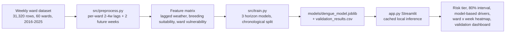

# System Architecture: Urban Dengue Outbreak Early-Warning Engine

## 1. End-to-End Data Flow

## 2. Forecasting Design (true 2-4 week lead)
* Features for a ward-week `s` use weather from weeks `s-2, s-3, s-4` only (`groupby(ward_id).shift`, no cross-ward leakage). No past case counts are used.
* Let `T` be the last observed weather week. Three models forecast cases at `T+2`, `T+3`, `T+4`: the 3- and 4-week models are trained with the target shifted forward, so they use weather that is 3-5 and 4-6 weeks older than the target week. All three use the same feature row (built from weather up to `T`), so the dashboard issues a real forecast beyond the last data point (`add_future_rows` appends 2 empty weeks per ward).
* `derive_features()` is the single formula used by training, the scenario simulator and the driver explanation, so they cannot drift apart.
* Aedes breeding suitability: Gaussian temperature peak at 29 C and humidity ramp, interacted with ward `water_logging_risk_index`, `population_density_sqkm` and `(1 - sanitation_score)`.

## 3. Chronological Validation Split
* Split by **target week**: train `< 2024-01-01` (24,780 ward-weeks for the 2-week model), test `>= 2024-01-01` (6,300 ward-weeks). No shuffling, no future information in training.
* Interval dispersion and model comparison use a validation window (2022-2023, trained on `< 2022`) only; the 2024-2025 test set is used once for final numbers.

| Horizon | Ridge MAE | HGB MAE | HGB RMSE | R2 | Tier acc. | High/Critical alert recall / precision | 80% interval coverage* |
| :--- | :---: | :---: | :---: | :---: | :---: | :---: | :---: |
| +2 weeks | 1.1191 | **0.9471** | 1.8871 | 0.7611 | 86.13% | 63.1% / 68.3% | 83.9% |
| +3 weeks | 1.2811 | **0.9912** | 1.915 | 0.754 | 85.25% | 61.9% / 64.4% | 90.4% |
| +4 weeks | 1.5437 | **1.2416** | 2.4963 | 0.582 | 83.0% | 64.9% / 54.0% | 86.1% |

\*coverage on weeks with >= 3 predicted cases. Accuracy falls with horizon, as expected: older weather carries less information.

### Risk tiers and why overall accuracy is not enough
Tiers use fixed weekly-case cut-offs: Low < 3, Medium 3-<8, High 8-<15, Critical >= 15 (operational assumptions to be tuned with health officers). On the holdout the actual tier shares (2-week model) are Low 72.0%, Medium 16.7%, High 9.6%, Critical 1.8%. Because Low dominates, tier accuracy overstates quality; per-tier recall is Low 95.0%, Medium 73.1%, High 52.5%, Critical 30.6%. Rare extreme weeks are the hardest to catch; the dashboard shows the full confusion matrix.

## 4. Model Selection Rationale
Reproduce with `python src/compare_models.py` (2-week horizon, validation window 2022-2023):

| Model | Val MAE | Val RMSE | Val Tier acc. | Fit time |
| :--- | :---: | :---: | :---: | :---: |
| ExtraTrees | 1.1285 | 2.2188 | 84.89% | 4.8s |
| RandomForest | 1.1502 | 2.2616 | 84.25% | 25.64s |
| HistGradientBoosting (Poisson) — chosen | 1.1612 | 2.3523 | 84.09% | 0.33s |
| Poisson GLM (scaled) | 1.2163 | 2.4229 | 83.61% | 0.15s |
| Ridge | 1.2753 | 2.3525 | 83.96% | 0.05s |

ExtraTrees is marginally better on validation MAE, but the differences among tree models are small. We keep Poisson HistGradientBoosting: a count-appropriate objective, ~0.3 s to fit, a ~1 MB artifact for all three horizons, and a natural fit for fast cached inference. Ridge is kept as the baseline.

* **Forecast interval:** 80% Negative-Binomial range around the model mean; dispersion chosen on the validation window only.
* **Driver breakdown:** for each driver group (rainfall lags, temperature, humidity, water-logging, density, sanitation) the dashboard re-predicts with that group set to its median and reports the change in forecast cases. This is model-based (counterfactual), not a raw input scale.

## 5. Compute & API Cost Controls
1. **Serialized models:** `joblib` artifact loaded once with `@st.cache_resource`; inference for 3 horizons + 7 driver counterfactuals is a single small batch (milliseconds).
2. **Feature cache:** engineered features cached in `models/processed_features_v2.pkl` (git-ignored, rebuilt automatically); Excel read with the fast `calamine` engine; `@st.cache_data` for frames.
3. **Zero external API calls** in this prototype. Planned production guardrails: one batched weather fetch per city per day cached in SQLite/Redis; any LLM advisory generated only on a High/Critical tier change, `max_tokens=250`, de-duplicated per `(ward_id, week)`.

## 6. Operations Layer (spray/cleanup schedule + alerts)
* **Input:** the same cached model forecast used by the heatmap (one batch predict per city, ~60 rows). No extra model, no extra API.
* **Ranking:** wards sorted by risk tier (Critical > High), then forecast cases, then waterlogging index.
* **Scheduler (`operations.build_schedule`):** greedy, capacity-aware. Capacity per day = teams x wards-per-team, separately for spray teams and cleanup teams; Friday is off. Pass 1 places first visits in priority order (Critical wards first); pass 2 places follow-ups at least 7 days later (re-spray for Critical, inspection for High/Critical). Tasks that do not fit in 14 days are reported as a capacity shortfall.
* **Alerts:** only for High/Critical wards. Deterministic Bangla/English templates (zero LLM tokens); SMS length is checked against UCS-2 limits (70/67 characters per segment). Sending is simulated (console + outbox CSV); a `wa.me` click-to-chat link gives a real hand-off with no paid API. Production path: Twilio/BulkSMS BD behind a queue, one message per `(ward_id, week, audience)`.

## 7. Phase 2: Resource Optimisation, Routing, Simulation, Dispatch
**Data flow:** model forecast per ward (selected horizon) -> demand -> constrained allocation -> bed routing -> dispatch notices/briefs. The what-if simulator re-enters the model with a modified ward feature. Everything runs locally; no network call exists in these paths (offline kill-switch safe).

**Demand.** The onsite dataset's `saline_bags_needed`, `diagnostic_kits_needed`, `hospital_beds_required` are exact functions of weekly cases: `round_half_up(cases x k)` with k = 2.385, 1.164, 0.298 reproduces all 31,320 rows (100% match). We apply the same ratios to predicted cases.

**Allocation.** `priority = tier_weight(1/1.5/2/3) x predicted_cases x (density / mean density)`. Regional stock = `stock% x total demand`, filled in priority order (greedy), so a scarce stock serves high-risk, dense wards first. Any ward with allocated < required raises a deficit alert; below 50% is flagged critical. Crews needed per tier (Critical 3, High 2, Medium 1) are assigned in priority order up to the crew total.

**Overflow routing.** Ward bed capacity is **not in the dataset**: assumed = 50% of the ward's largest weekly bed demand in 2016-2025 (min 2 beds), adjustable by slider. Per city only: wards above capacity send overflow to the ward with the most headroom, repeating until placed or the city is full; leftover = unplaced patients (city-wide shortage). Reported: net ward deficit, transfers, city utilisation before/after, headroom left. Invariants tested: transfers never cross cities, never exceed headroom, patients are conserved.

**Simulator.** Each crew removes 25% of the remaining breeding habitat (max 75%, diminishing returns) by scaling `water_logging_risk_index`; `derive_features()` rebuilds the model inputs and the three horizon models re-predict (+2/+3/+4 weeks). Prevented cases = baseline - after, summed over the three weeks; beds/saline saved via the same demand ratios; ROI = prevented / crews; crews are added greedily by best marginal gain. The 25% rate is an assumption, not field-validated, and this is a model counterfactual, not a causal estimate.

**Cost/offline.** One batched model call per city-week for the forecast; the simulator's 5 crew levels x 3 horizons x 60 wards are computed once and cached (`st.cache_data`), so sliders and crew changes are instant. Dispatch notices and HTML briefs are templates with inline CSS and system fonts (no CDN, no LLM).

**Likely Q&A answers.** *Why these ratios?* Fitted from the dataset, exact match. *Why greedy priority?* Transparent and defensible under scarcity; risk, volume and crowding all enter. *Why is capacity 50%?* Dataset has no capacity; it is an explicit, adjustable assumption. *Is the simulator causal?* No, it is a model-based what-if with a stated effect size.

## 8. Roles: Viewer and Admin
Two roles, held in the server-side Streamlit session (`auth.py`). Control widgets are only rendered for the admin, so a viewer's browser never receives them; the same pages show a read-only banner with the current admin settings instead. Admin decisions (stock %, crews, capacity assumption, simulator crews/wards, team settings) are persisted in `admin_settings.json` (`settings_store.py`, atomic write, defaults if missing or corrupt) so all viewers see the same plan. Password comes from a secret or env var, compared in constant time, with a 5-try lock per session. Limits: this is a prototype access gate, not user management; the role resets on page refresh.
